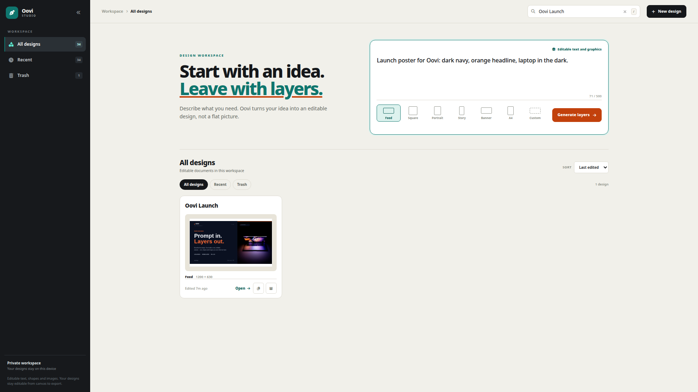
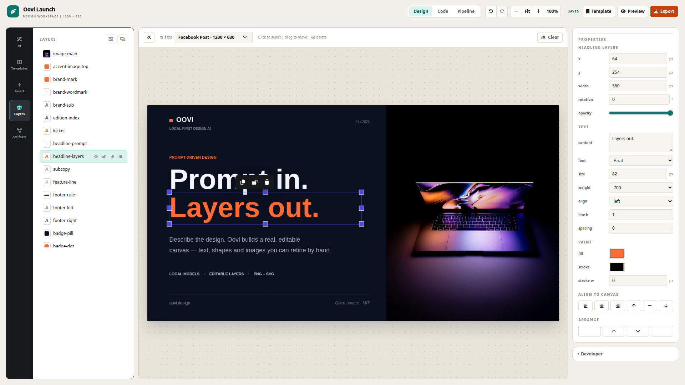

# Oovi: AI Design Studio

Oovi turns natural-language prompts into **fully editable graphic designs** - not flat images. Every headline, shape, and image stays a live Fabric.js object: selectable, movable, resizable, and re-editable.






**Prompt to plan to validated Design DSL to editable canvas.**

## Demo

- **Captioned real demo (52s):** [docs/Screencast_20261024_210545_captioned.mp4](docs/Screencast_20261024_210545_captioned.mp4) - 01 Prompt → 02 Brief → 03 Pipeline → 04 Editor → 05 Manual edit → 06 Saved design opened from library.
- **Captioned real demo (52s):** [docs/Screencast_20261024_210545_captioned.mp4](docs/Screencast_20261024_210545_captioned.mp4) - 01 Prompt → 02 Brief → 03 Pipeline → 04 Editor → 05 Manual edit → 06 Saved design opened from library.
- **36-second product film:** [docs/oovi-promo.mp4](docs/oovi-promo.mp4) - the short visual overview.
- **Run it locally:** [docs/DEMO.md](docs/DEMO.md) has prerequisites and a click-by-click demo script.

The walkthrough is a real screen recording of the local app. It opens a saved design and demonstrates editing and export; the model pipeline is shown as an explanatory card because a full CPU generation takes minutes. No hosted AI service is used. The product film is a separate visual trailer.

## The problem

AI image generators are good at producing a finished-looking picture. They are bad at producing something a person can keep working on. The output is a flat bitmap: changing a headline, swapping a photo, or fixing one line of copy means starting over.

Traditional design tools have the opposite problem. They are fully editable, but turning a brief into a layout still takes manual work.

Oovi closes that gap. AI plans the design, but it writes a structured document instead of a picture. The result opens as a real canvas with separate text, image, shape, and decoration layers.

## What Oovi does

1. You describe the design you need.
2. Oovi refines the brief, chooses a readable palette, retrieves a compatible layout, and writes the copy.
3. Each region is generated as Design DSL and checked by deterministic validators.
4. A quality gate scores the rendered layout and repairs only the regions that need it.
5. The validated document is rendered into editable Fabric.js objects.
6. You edit anything by hand, ask for a targeted AI change, and export.

The AI is not a chat box bolted onto an editor. Its output is the document the rest of the system uses.

## Features

- **AI generation that stays editable.** A planner chooses a layout and palette; each region is filled with structured Design DSL. Nothing is baked into a bitmap.
- **Template-first pipeline.** A reusable layout library gives every design a collision-free structure, then the model tunes and fills it.
- **Home dashboard.** Prompt-first hero, size presets, recent designs, rename, duplicate, trash/restore, and open-in-new-tab.
- **Full editor.** Select, drag, resize, rotate, inline text editing, multi-select, layers, context toolbar, and AI-assisted edits.
- **Reliable history.** Post-state undo/redo; empty floors are no-ops and new edits clear redo.
- **Query-driven imagery.** Unsplash searches are grounded in the brief, so images follow the prompt instead of a random asset.
- **Closed decoration vocabulary.** The model picks circles, arcs, stars, dots, grids, squiggles, brackets, ribbons, pills, dividers, icons, or patterns; the renderer expands them into editable primitives.
- **Copy that cannot ship broken.** A single copy deck writes all regions first. Strict repetition and deterministic guards catch duplicates, instruction leakage, meta-copy, and ungrounded claims.
- **Quality and repair.** Generations are scored for coverage, balance, contrast, hierarchy, and hero presence; only failing regions are regenerated.
- **Export, persistence, offline mode.** PNG/JPG/SVG/PDF, Postgres autosave with soft-delete trash, and `?mock=1` for a model-free UI run.

## How it works

```text
Prompt
  > L1 goal        refine the brief                  src/ai/layerPrompt.js
  > L2 palette     choose a readable palette          src/ai/aiClient.js
  > L3 template    choose and tune a layout           src/ai/aiClient.js
  > L3c copy deck  write every region once            src/ai/copyPrompt.js
  > L4 regions     DSL and Unsplash per region        src/ai/architectPrompt.js
  > L5 color       palette and contrast repair        src/ai/colorCorrect.js
  > validate       structural checks                  src/design/designValidator.js
  > quality        non-mutating score                 src/ai/quality.js
  > render         editable Fabric objects            src/renderer/fabricRenderer.js
```

- **Streaming, not waiting.** `POST /api/ai` returns NDJSON progress events, so long local-model runs keep moving and the UI shows a live token count.
- **Per-region refinement.** Quality findings map back to the regions that own the offending elements. A region is regenerated atomically; a template-level problem re-tunes the same template instead of switching layouts.
- **Visible template while it fills.** The chosen layout appears immediately with sample copy and image placeholders. Each validated region replaces its sample in one undo step.
- **Copy is validated, never guessed.** Rejected deck lines get one focused repair pass. The final guard restores approved lines or drops unusable text; it does not inject generic fallback copy.

### Design DSL

The DSL is the contract between AI and canvas: plain JSON with a canvas and a flat element list.

```json
{
  "canvas": { "width": 1080, "height": 1080, "background": "#14101F" },
  "elements": [
    { "id": "headline", "type": "text", "role": "headline",
      "content": "Ship Something Spooky", "x": 64, "y": 100,
      "width": 560, "fontSize": 84, "fontWeight": 800, "fill": "#FFFFFF" },
    { "id": "hero", "type": "image", "role": "hero",
      "x": 700, "y": 80, "width": 440, "height": 440, "src": "..." }
  ]
}
```

Element types: `text`, `rectangle`, `circle`, `line`, `image`, `group`. Every Fabric object keeps its DSL `id` as `obj.designId`, so editing, history, and export round-trip through the same document.

Routes are hash-based: `#/` dashboard, `#/design/new` blank canvas, `#/design/<id>` saved design.

## Architecture

```text
Browser (Vite + vanilla JS + Fabric.js)
  Dashboard / Prompt / Editor / Layers / Assistant / Export
        |
        | same-origin fetch, NDJSON progress
        v
API (Node stdlib HTTP locally, Vercel functions in production)
  /api/ai       -> api/ai.js -> api/_aiChain.js -> Ollama /api/chat
  /api/photos   -> Unsplash proxy
  /api/designs  -> Postgres CRUD, trash, autosave
        |
        v
Local open-weight model (Ollama + Gemma)
```

The full data flow, quality gates, failure handling, and design decisions are in [docs/ARCHITECTURE.md](docs/ARCHITECTURE.md).

## AI models and open-weight stack

Oovi uses **open-weight models only**. There is no OpenAI, Anthropic, Gemini, Azure, or other closed AI API in the product path.

| Role | Model | Runtime | Notes |
|---|---|---|---|
| Default planning and generation | `gemma4:e2b` | Local Ollama | Set with `OLLAMA_MODEL` |
| Narrow-layer adapter | `oovi-gemma3-270m:q8` | Local Ollama | LoRA adapter in `model/`, base `google/gemma-3-270m` |
| Smaller fallback layers | `gemma3:1b`, `gemma3:270m` | Local Ollama | Optional per-layer overrides |
| Background removal | `@imgly/background-removal` | Local ONNX in the browser | Optional, lazy-loaded, AGPL-3.0 |
| Reference OCR | Tesseract.js | Local in the browser | Optional, Apache-2.0 |
| Stock photography | Unsplash API | Remote, non-AI | No generated imagery |

The 270M adapter is deliberately narrow: it handles template choice, bounded tuning, and one-region copy fills. The larger Gemma model handles the open-ended layers. The adapter's smoke evaluation is in its model card and is not a quality claim for the whole pipeline.

Every AI response is parsed, validated, quality-scored, and consumed as structured design data. No model response is shown to the user as a chat answer. The exact file/function disclosure is in [docs/AI_USAGE.md](docs/AI_USAGE.md).

## Quickstart

**Prerequisites:** Node.js 20+ (recommended), PostgreSQL 14+, and [Ollama](https://ollama.com) for real generation.

```bash
cp .env.example .env
# Edit .env: set your Postgres credentials and OLLAMA_MODEL.
npm install
createdb oovi
ollama pull gemma4:e2b
node scripts/db-probe.mjs

# Terminal 1 - API and persistence (:3001)
npm run dev:api

# Terminal 2 - editor UI (:5173)
npm run dev
```

Open `http://localhost:5173`, describe a design, and it opens in the editor.

For a model-free UI check, set `VITE_MOCK_AI=1` in `.env` and restart the dev server. Mock mode exercises the editor and persistence but does not call a model.

## Configuration

Copy `.env.example` to `.env`. Keys are server-only unless prefixed with `VITE_`.

| Variable | Scope | Purpose |
|---|---|---|
| `OLLAMA_URL` / `OLLAMA_MODEL` | Server | Local Ollama endpoint and default model |
| `OLLAMA_MODEL_TUNE` / `OLLAMA_MODEL_COPY_DECK` / `OLLAMA_MODEL_COPY` / `OLLAMA_MODEL_FALLBACK` | Server | Optional per-layer model overrides; blank falls back to `OLLAMA_MODEL` |
| `AI_CHAIN` | Server | Provider chain; `ollama` is the only supported provider |
| `VITE_UNSPLASH_ACCESS_KEY` | Browser | Unsplash photo search (public, rate-limited) |
| `PGHOST` / `PGPORT` / `PGUSER` / `PGPASSWORD` / `PGDATABASE` | Server | Postgres connection (`server/index.js`) |
| `VITE_MOCK_AI=1` | Browser | Offline mode with no model calls |

> Never put a secret in a `VITE_`-prefixed variable; those values are bundled into the client.

### Feature config

Density and copy behavior live in one place: [`src/config/features.js`](src/config/features.js).

```js
export const FEATURES = {
  layout: {
    density: "tight",              // tight | dense | normal | airy
    coverageTarget: 0.8,           // share of each reserved box L4 should fill
    gutters: { tight: 0.42, dense: 0.6, normal: 0.82, airy: 1.2 },
  },
  decoration: {
    density: "dense",              // sparse | normal | dense
    maxPieces: 24,
    counts: { sparse: 0.8, normal: 1.15, dense: 1.6 },
    builders: { /* base/min/max per shape family */ },
  },
  copy: {
    strictRepetition: true,        // reject cross-region word reuse
    repairPasses: 2,               // 1 = first repair only, 2 = strict follow-up
    maxRegionRepairs: 2,
    regenerateBadCopy: true,       // retry L4 instead of dropping the line
  },
};
```

Change a value, reload, and every layer reads the same setting. No prompt or validator edits required.

### AI provider

Generation runs on **open-weight models only**, served locally by Ollama. The browser calls the same-origin `/api/ai` route; prompts use strict JSON schemas and no AI key reaches the client.

```bash
ollama pull gemma4:e2b
```

Set `OLLAMA_MODEL` to whichever local model you run. On CPU-only machines, the narrow layers can use a smaller quantized model such as `oovi-gemma3-270m:q8` while a larger model handles the broader layers. The copy deck defaults to `OLLAMA_MODEL`; set `OLLAMA_MODEL_COPY_DECK` only when testing a stronger model for that one call.

The optional adapter is documented in [`model/oovi-gemma3-270m/README.md`](model/oovi-gemma3-270m/README.md).

## Project structure

```text
src/
  ai/            layered pipeline, prompts, client, mocks, quality gate
  app/           App.js orchestration (generation, persistence, history, panels)
  components/    Dashboard, TopBar, InsertPanel, AssistantPanel, DebugTabs, ...
  config/        Central feature config (density, decoration, copy rules)
  design/        DSL schema, validator, canvas presets, design types
  editor/        Fabric canvas wrapper, history, layers, toolbar
  layout/        Templates, layout engine, type scale, palettes, decorations
  reference/     Reference-image analysis (color, OCR, shapes, layout)
  renderer/      Design DSL <-> Fabric.js (the only Fabric touchpoint)
  storage/       REST client for /api/designs
  ui/            Hash router, shell, toasts, brand tokens
server/          Local API (stdlib node:http): designs CRUD, trash, photo/AI proxy
api/             Shared serverless handlers (Vercel and local server)
scripts/         Probe scripts (db, api, history, quality, trash, ...)
tests/           Node test suites, run through the Vite bundler
```

Supporting docs:

- [docs/ARCHITECTURE.md](docs/ARCHITECTURE.md) - pipeline and data flow
- [docs/AI_USAGE.md](docs/AI_USAGE.md) - exact AI usage and model disclosure
- [docs/LIMITATIONS.md](docs/LIMITATIONS.md) - known limits and future work
- [docs/DEMO.md](docs/DEMO.md) - setup and demo script
- [THIRD_PARTY.md](THIRD_PARTY.md) - licenses and model terms
- [DESIGN.md](DESIGN.md) - visual identity and tokens

## Scripts

| Command | Purpose |
|---|---|
| `npm run dev` | Vite dev server (`:5173`, proxies `/api` to `:3001`) |
| `npm run dev:api` | Local API and Postgres backend (`:3001`) |
| `npm run build` | Production build |
| `npm run preview` | Preview the production build |
| `npm test` | Run the full test suite |
| `node scripts/quality-check.mjs` | Quality-gate fixture suite |
| `node scripts/db-probe.mjs` | Database connectivity check |

## Limitations and future work

- CPU inference is slow, and a single Ollama slot serializes requests. The UI streams progress, but generation still takes minutes on CPU.
- The targeted assistant edit can fail to return recoverable JSON on small CPU models; manual editing is the reliable path and is what the walkthrough demonstrates.
- Quality depends on the local model. The 270M adapter is narrow and its smoke evaluation is limited.
- Layouts come from a curated template library and a closed decoration vocabulary. Arbitrary vector illustration is not supported.
- Imagery comes from Unsplash or placeholders. There is no generated-image path in the submitted build.
- Persistence requires Postgres. There is no authentication, multi-user workspace, or real-time collaboration.
- Export fidelity depends on available system fonts. CMYK and print-production workflows are out of scope.
- The interface is English-first. Nepali localization, accessibility auditing, and mobile editing are future work.

See [docs/LIMITATIONS.md](docs/LIMITATIONS.md) for the full list.

## Verification

```bash
node --version
npm ci
npm test
npm run build
node scripts/db-probe.mjs
```

The app has no closed AI provider and no hosted image-generation dependency. `.env` is gitignored and never committed. The product calls a local Ollama server through the same-origin `/api/ai` gateway and uses Unsplash for non-AI photo search.

## License

Oovi-authored source is released under the **MIT License**. Copyright (c) 2026 Devsdenepal. See [LICENSE](LICENSE).

Third-party packages and model weights keep their own licenses. The Gemma adapter inherits the Gemma Terms of Use from `google/gemma-3-270m`; the optional background-removal package is AGPL-3.0. See [THIRD_PARTY.md](THIRD_PARTY.md) for the full list.

## Acknowledgements

Built with [Fabric.js](https://fabricjs.com/), [Vite](https://vitejs.dev/), [Ollama](https://ollama.com), [Gemma](https://ai.google.dev/gemma), and [Unsplash](https://unsplash.com/). The local model adapter was trained with PEFT/LoRA on Gemma 3 270M.
