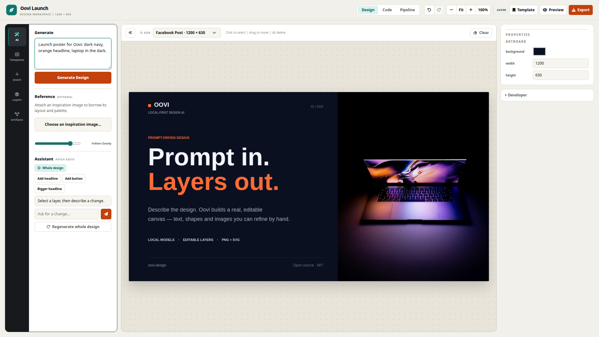

# Oovi: AI Design Studio

Oovi turns natural-language prompts into **fully editable graphic designs**. Not flattened images. Every headline, shape, and illustration the AI produces remains a live object on a Fabric.js canvas: selectable, movable, resizable, and re-editable.



**From prompt to composition plan to validated Design DSL to an editable Fabric.js canvas.**

## Features

- **AI generation that stays editable**: an architect planner produces a deliberate layout (palette, sections, boxes), then each component is generated as structured Design DSL or AI imagery. Nothing is ever baked into a single bitmap.
- **Home dashboard**: prompt-first hero, size presets, recent designs with thumbnails, rename, duplicate, trash with restore, and one-click open in a new tab.
- **Full editor**: select, drag, resize, rotate, inline text editing, multi-select, layers panel, context toolbar, and AI-assisted edits.
- **Reliable undo/redo**: post-state history where the current canvas is always on top; empty floors are no-ops and new edits clear the redo stack.
- **Imagery, server-side**: AI illustrations via Pollinations and photo search via Unsplash, both proxied through the backend so API keys never reach the browser.
- **Background removal**: one-click subject isolation for local images.
- **Export**: PNG, JPG, SVG, and PDF.
- **Autosave + Postgres persistence**: designs save to a local Postgres database with debounced autosave and soft-delete trash.
- **Layout quality gate**: every generation is scored on coverage, balance, contrast, hierarchy, and hero presence, with findings reported in the assistant panel.
- **Offline mock mode**: `?mock=1` (or `VITE_MOCK_AI=1`) runs the full pipeline with zero network calls.

## Quickstart

**Prerequisites:** Node.js 18+, and PostgreSQL for design persistence.

```bash
npm install

# Terminal 1: API + persistence layer (http://localhost:3001)
npm run dev:api

# Terminal 2: editor UI (http://localhost:5173)
npm run dev
```

Create the database once (defaults in `.env`, see [Configuration](#configuration)):

```bash
createdb oovi
node scripts/db-probe.mjs   # verifies schema + connectivity
```

Then open `http://localhost:5173`, describe a design on the home page, and it opens in the editor.

## How it works

```text
User prompt
  > Architect plan (sections, palette, theme, boxes)      src/ai/architectPrompt.js
  > Per-component DSL  ·  Pollinations / Unsplash images  src/ai/aiClient.js, api/
  > validateDesign() (structural)                         src/design/designValidator.js
  > evaluateDesign() (quality report, non-mutating)       src/ai/quality.js
  > Fabric.js render (editable objects, history-tracked)  src/renderer/fabricRenderer.js
```

The **Design DSL** is the contract between AI and canvas: a plain-JSON document of canvas + elements:

```json
{
  "canvas": { "width": 1080, "height": 1080, "background": "#14101F" },
  "elements": [
    { "id": "headline", "type": "text", "role": "headline",
      "content": "Ship Something Spooky", "x": 64, "y": 100,
      "width": 560, "fontSize": 84, "fontWeight": 800, "fill": "#FFFFFF" },
    { "id": "hero", "type": "image", "role": "hero",
      "x": 700, "y": 80, "width": 440, "height": 440, "src": "…" }
  ]
}
```

Element types: `text`, `rectangle`, `circle`, `line`, `image`, `group`. Every rendered Fabric object keeps its DSL `id` as `obj.designId`, so AI edits, history snapshots, and export all round-trip through the same document.

Routes are hash-based: `#/` dashboard, `#/design/new` blank canvas, `#/design/<id>` saved design.

## Configuration

Copy `.env.example` to `.env`. Keys are **server-only** unless prefixed `VITE_`:

| Variable | Where | Purpose |
|---|---|---|
| `VITE_GROQ_MODEL` | Browser | Model hint sent with each request (each rung uses its own configured model) |
| `GROQ_API_KEY` / `GEMINI_API_KEY` / `OPENROUTER_API_KEY` | Server only | Open-weight AI chain (`api/_aiChain.js`) |
| `OLLAMA_URL` / `OLLAMA_MODEL` | Server only | On-device open-weight rung (Ollama) |
| `POLLINATIONS_KEY` | Server only | AI image generation (`api/asset.js`) |
| `UNSPLASH_ACCESS_KEY` | Server only | Photo search (`api/photos.js`) |
| `PGHOST / PGPORT / PGUSER / PGPASSWORD / PGDATABASE` | Server only | Postgres connection (`server/index.js`) |
| `VITE_MOCK_AI=1` | Browser | Offline mode, no network calls |

> Never put a secret in a `VITE_`-prefixed variable. Those are bundled into the client. The browser holds no image or database credentials.

### AI providers — open-weight chain

Every generation runs on **open-weight models only**. A single POST to the
same-origin `/api/groq` route walks a server-side chain
([`api/_aiChain.js`](api/_aiChain.js)) and returns the first success, so a
rate limit or outage on one provider never drops a component. Prompts use
strict JSON schemas; the key never reaches the browser.

| Rung | Model | Host | Notes |
|---|---|---|---|
| 1 | `openai/gpt-oss-120b` | Groq | Apache-2.0; free tier (30 req/min, 8k TPM) |
| 2 | `gemma-4-31b-it` | Gemini API | open weights; separate quota pool |
| 3 | `nvidia/nemotron-3-super-120b-a12b:free` | OpenRouter | open weights; free tier |
| 4 | `gpt-oss:20b` | **Ollama (on-device)** | open weights, ~12 GB — fits 16 GB RAM |

Order is set by `AI_CHAIN` in `.env`. Any failure — `429`, `5xx`, network,
timeout, or empty body — advances to the next rung. Only cheap transient
faults retry on the same provider; a rate limit advances immediately.
`VITE_MOCK_AI=1` skips the network entirely.

**Rung 4 is on-device and needs no key** ([Ollama](https://ollama.com)):

```bash
ollama pull gpt-oss:20b
# our prompts exceed Ollama's 2048-token default context:
setx OLLAMA_CONTEXT_LENGTH 8192
```

It sits last as an offline fallback so a slow CPU model can never stall a
generation; when Ollama is not running the rung falls through in ~1.5 s.
Put `ollama` first in `AI_CHAIN` to make on-device primary.

> The chain is the only way out of the app: there is no second gateway and
> no client-side provider switch, so no call can bypass the open-weight
> rungs above. Adding or reordering a provider means editing
> `api/_aiChain.js`.

## Project structure

```text
src/
  ai/            AI client, architect/component prompts, mock provider, quality gate
  app/           App.js: orchestration (generation, persistence, history, panels)
  components/    Dashboard, TopBar, InsertPanel, AssistantPanel, DebugTabs, …
  design/        DSL schema, validator, canvas presets, design types
  editor/        Fabric canvas wrapper, HistoryManager, layers, toolbar
  layout/        Layout engine, semantic validation, type scale
  reference/     Reference-image analysis (color, OCR, shapes, layout)
  renderer/      Design DSL ↔ Fabric.js (only place that touches Fabric)
  storage/       REST client for /api/designs
  ui/            Hash router, design shell, toasts, brand tokens
server/          Local API (stdlib node:http): designs CRUD, trash, asset/photo proxy
api/             Shared serverless handlers (Vercel + local server)
scripts/         Probe scripts per flow (db, api, history, quality, trash, …)
```

Supporting docs: `AGENT.md` (agent working agreement), `DESIGN.md` (visual identity + token rules), `DECISIONS.md` (decision log).

## Scripts

| Command | Purpose |
|---|---|
| `npm run dev` | Vite dev server (`:5173`, proxies `/api` → `:3001`) |
| `npm run dev:api` | Local API + Postgres backend (`:3001`) |
| `npm run build` | Production build |
| `npm run preview` | Preview the production build |
| `node scripts/quality-check.mjs` | Quality-gate fixture suite |
| `node scripts/db-probe.mjs` | Database connectivity check |

## Tech stack

Vanilla JavaScript, [Fabric.js](https://fabricjs.com/) canvas, Vite build, Node.js stdlib HTTP API, PostgreSQL (`pg`), Pollinations + Unsplash for imagery, `@imgly/background-removal` and jsPDF loaded lazily. No frontend framework, no hidden dependencies.
