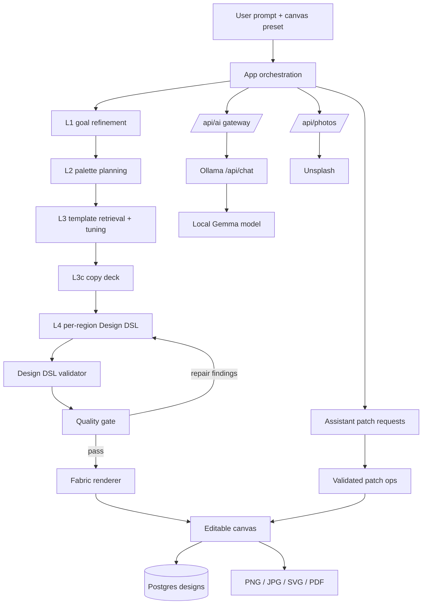

# Architecture

Oovi is a local-first AI design studio. The model produces a structured document, not a bitmap. The browser edits that document through Fabric.js, and the same document round-trips through validation, persistence, and export.

## System view



The primary generation path is the architected one: `App.onGenerateArchitected()` in `src/app/App.js`. A direct whole-design path (`onGenerateDirect()`) remains for reference-image generation and as a fallback.

## Runtime boundaries

| Layer | Location | Responsibility |
|---|---|---|
| Browser UI | `src/` | Dashboard, prompt, editor, layers, assistant, export |
| Same-origin API | `server/index.js`, `api/` | Design CRUD, photo proxy, AI gateway |
| Local inference | Ollama | Runs the open-weight Gemma model |
| Persistence | PostgreSQL | Designs, thumbnails, AI memory, soft-delete trash |
| Rendering | Fabric.js | Canvas objects, selection, transforms, serialization |

The browser never talks to a model provider directly. It calls `/api/ai`; the server calls Ollama. There is no API key in the client and no provider-specific code in the browser.

## Generation pipeline

The pipeline is deliberately layered. Each layer has a narrow output contract and a deterministic fallback.

1. **L1 goal** (`refineGoal` in `src/ai/aiClient.js`): turns the raw prompt into a structured brief, audience, tone, and design type.
2. **L2 palette** (`planPalette`): chooses a palette with background, ink, accent, and supporting roles. A curated library can satisfy this layer without a model call.
3. **L3 template** (`planTemplate`): retrieves a shortlist of compatible layouts and asks the model to choose one and propose bounded tuning (variant, density, hide/scale/align).
4. **L3c copy deck** (`planCopyDeck`): writes every text region once. Deterministic guards reject duplicates, instruction leakage, meta-copy, and ungrounded claims.
5. **L4 regions** (`componentDesign` / `src/ai/architectPrompt.js`): fills one region at a time with Design DSL elements. Images are searched through Unsplash using prompt-grounded queries.
6. **L5 color** (`correctColors`): deterministic contrast and palette repair.
7. **Validate** (`validateDesign`): structural and semantic checks. Invalid designs are rejected or normalized.
8. **Quality gate** (`evaluateDesign`): scores coverage, balance, contrast, hierarchy, and hero presence. Findings are mapped back to the owning regions.
9. **Render** (`renderDesign`): converts the validated DSL into Fabric.js objects, preserving each DSL `id` as `obj.designId`.

Each region is applied as its own undo entry. The selected template appears immediately with sample content, then each region is replaced as its validated content lands.

## Design DSL

The DSL is the contract between the AI pipeline and the renderer.

```json
{
  "canvas": { "width": 1080, "height": 1080, "background": "#14101F" },
  "elements": [
    {
      "id": "headline",
      "type": "text",
      "role": "headline",
      "content": "Ship Something Spooky",
      "x": 64,
      "y": 100,
      "width": 560,
      "fontSize": 84,
      "fontWeight": 800,
      "fill": "#FFFFFF"
    }
  ]
}
```

Supported element types are `text`, `rectangle`, `circle`, `line`, `image`, and `group`. The validator checks bounds, required fields, font sizes, color values, image sources, and role constraints. The renderer is the only module that turns DSL into Fabric objects.

## Quality and repair

`src/ai/quality.js` is pure and non-mutating. It reports issues with severity and codes. The App maps each issue to the region that owns the offending element. Only that region is regenerated. A template-level issue re-tunes the same template instead of switching layouts.

Deterministic guards are intentionally separate from the model:

- `src/design/designValidator.js`: structure and element validity
- `src/ai/copySanitize.js`: repetition and copy-quality checks
- `src/ai/patch.js`: patch operation validation
- `src/ai/colorCorrect.js`: palette and contrast correction

This separation means the model cannot silently bypass a hard constraint.

## Streaming and failure handling

A local model can take minutes. `POST /api/ai` returns NDJSON events:

- `start`
- `progress` (token count and elapsed seconds, throttled)
- `delta` (optional live text)
- `done` (text, provider, model, usage, attempts)
- `error` (message, retryable, attempts)

The server uses Node's core HTTP client for the Ollama stream, not global `fetch`, so long generations are not cut off by a 300-second undici timeout. Ollama requests are serialized because the local model has one slot; fanning out would only queue and time out.

If a region fails, its template sample remains in place. If the copy deck cannot produce approved lines for every text region, generation stops before any region is rebuilt with unapproved copy.

## Persistence

`server/index.js` owns the local API and Postgres schema. Designs are stored as JSONB with a thumbnail, AI memory, timestamps, and a soft-delete column. The browser autosaves through `src/storage/`. Trash, restore, duplicate, and permanent delete are server routes.

## Local inference

The provider is fixed to Ollama in `api/_aiChain.js`. `runChain()` reads `AI_CHAIN` and accepts only registered providers; currently the only entry is `ollama`. `callOllama()` probes `/api/tags` for fast failure, calls `/api/chat` with `stream: true` and `think: false`, and returns the concatenated response.

Per-layer model overrides let a small adapter handle narrow JSON tasks while a larger model handles open-ended planning. The committed adapter is documented in `model/oovi-gemma3-270m/`.

## Optional reference analysis

When a reference image is attached, the app can use local OCR (`tesseract.js`) and local background removal (`@imgly/background-removal`) to analyze it. These are optional local models. They are not used in the default prompt-to-design path.

## Security and privacy

- `.env` is gitignored; no model key is required for Ollama.
- The browser only calls same-origin routes.
- Unsplash access is a public, rate-limited key; it is not a model credential.
- Designs stay in the local Postgres instance unless the operator deploys them.
- No closed AI provider is called from the product.

## Design decisions

- **Template-first, not free-form.** A curated layout library gives the model a collision-free starting point and makes generation tractable on CPU.
- **Structured output, not bitmaps.** The DSL is the product. Editability is not a post-processing step.
- **Validate before render.** The model is untrusted input. Validators and quality gates are the boundary.
- **Local-first inference.** The model can run without a paid API, and the app remains inspectable end to end.
- **One model at a time.** Serial region generation is slower to start but avoids queue timeouts and makes progress visible.

## Related documents

- [AI usage and exact file/function disclosure](AI_USAGE.md)
- [Limitations and future work](LIMITATIONS.md)
- [Demo and setup](DEMO.md)
- [Third-party licenses](../THIRD_PARTY.md)
